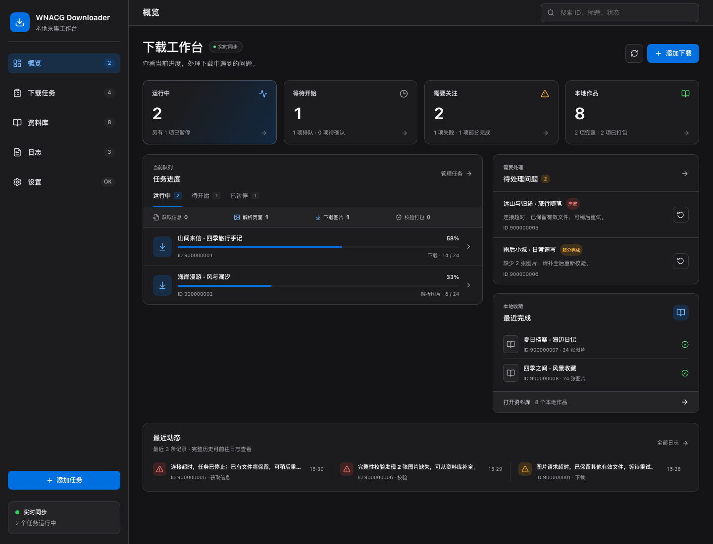
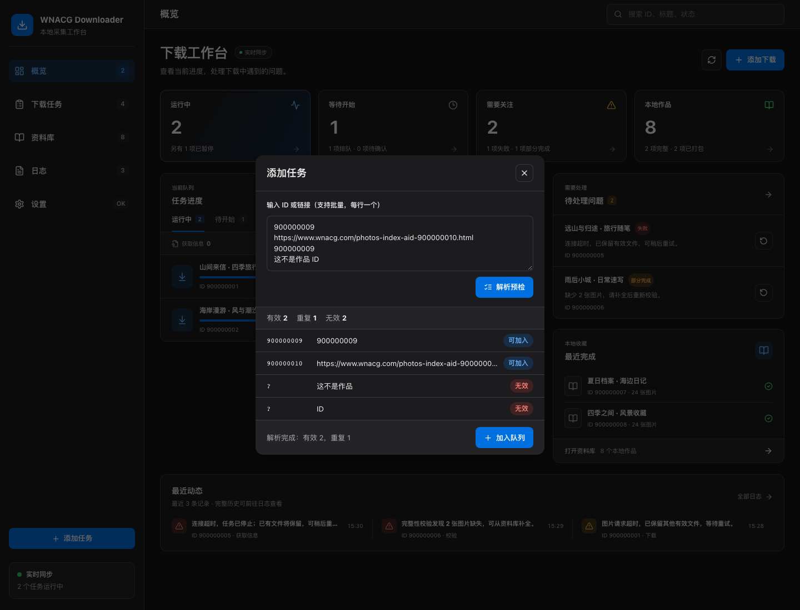
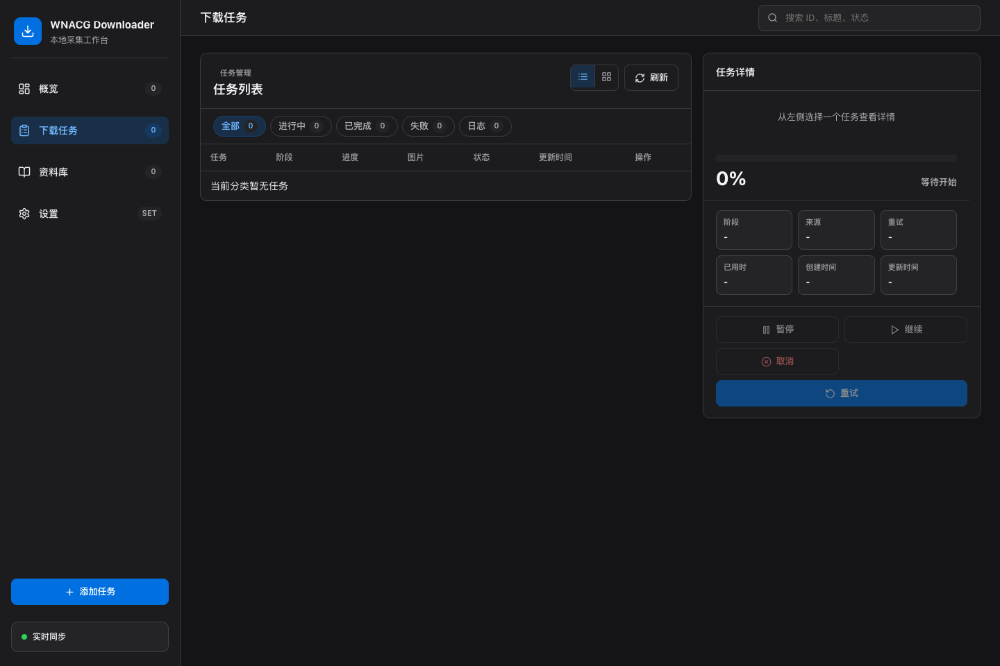
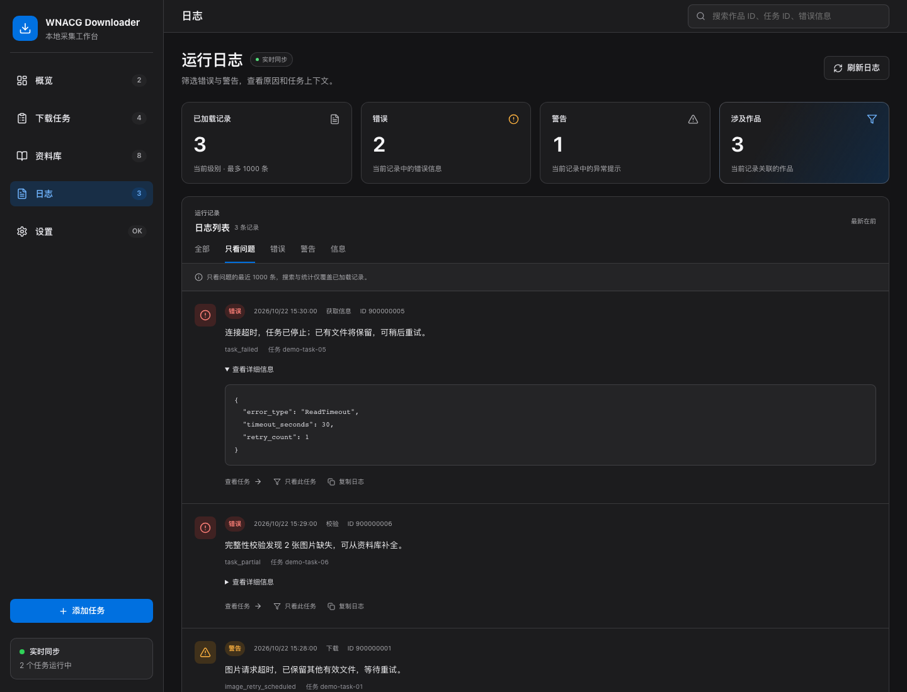
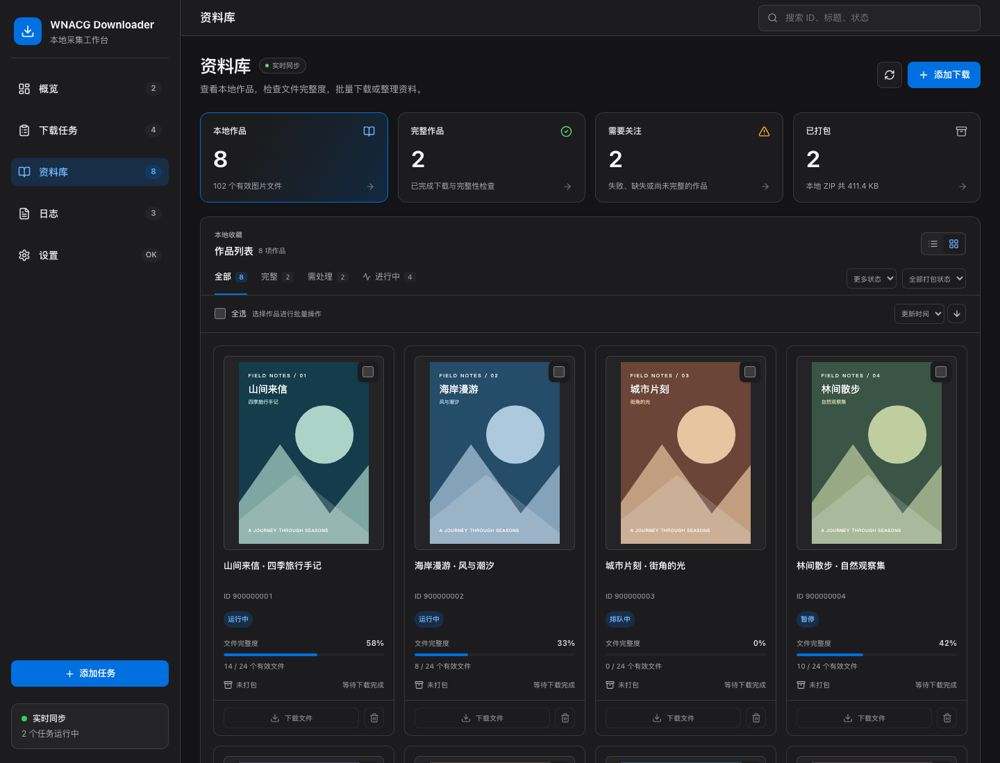
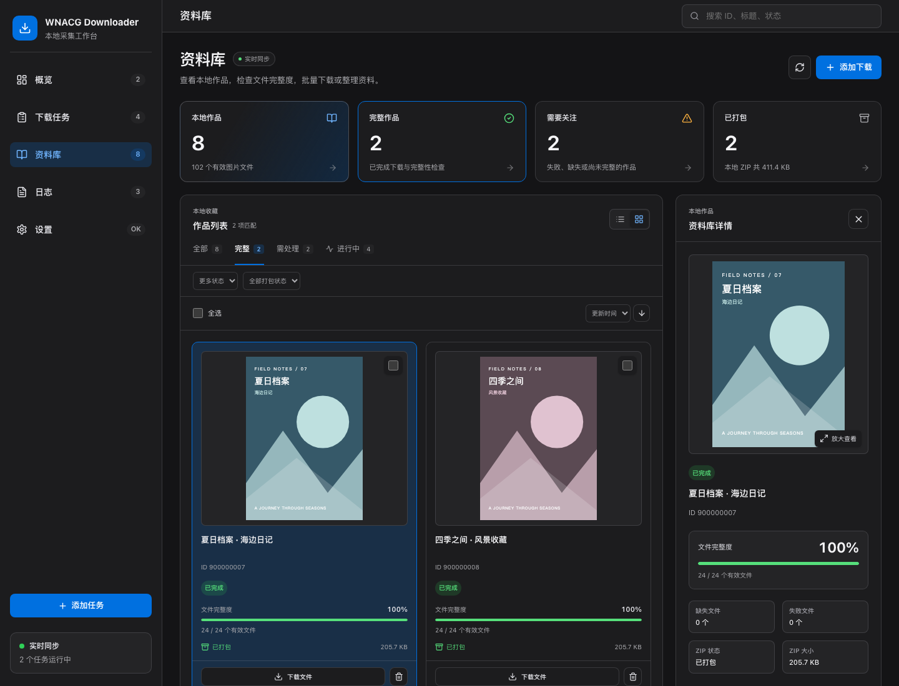
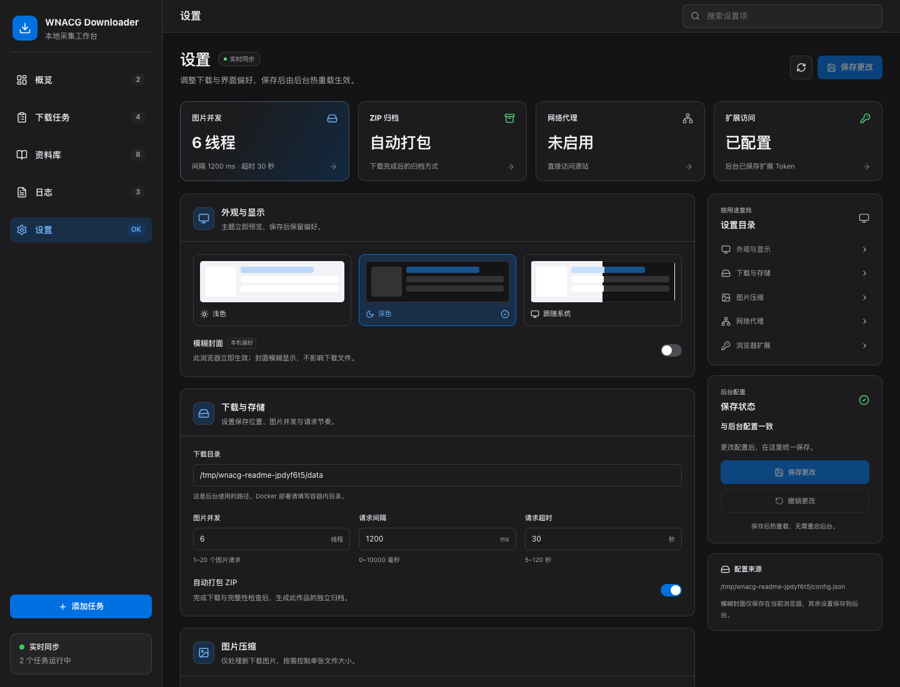
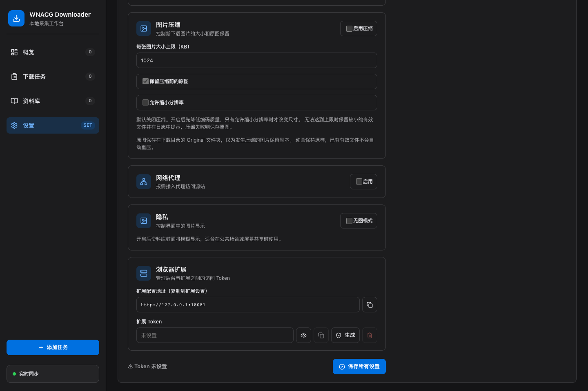
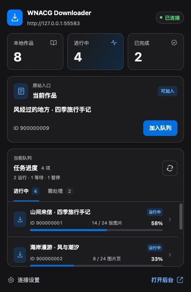
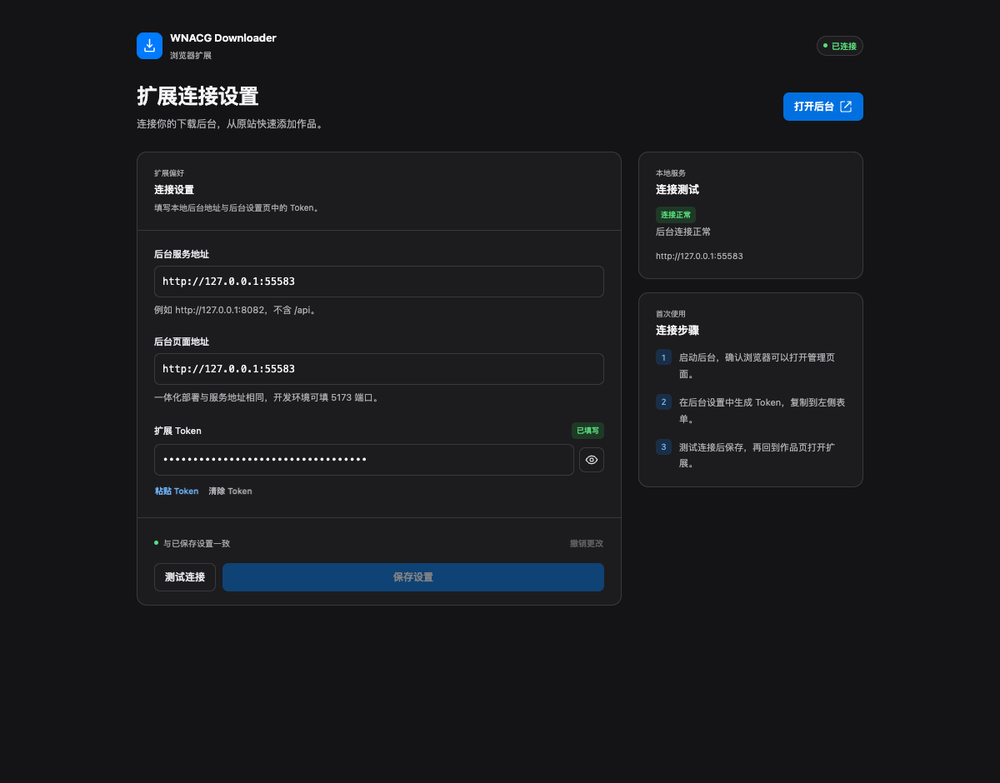

# WNACG Downloader

一个面向本机和可信内网的 WNACG 下载管理工具。通过 Web 后台批量添加任务、查看进度、管理本地资料库，并在下载后校验图片与 ZIP 的完整性。可选的 Chrome 扩展支持从站点页面直接提交任务。

当前为 **2.0 开发版本**，采用 [MIT License](LICENSE)。后台可独立使用；CLI / File Watch 尚未提供。

[界面截图](#界面截图) · [快速启动](#快速启动docker) · [使用方法](#使用方法) · [浏览器扩展](#浏览器扩展) · [配置说明](#配置说明) · [本地开发](#本地开发) · [文档](#文档)

## 功能

| 功能 | 说明 |
| --- | --- |
| 批量添加 | 输入漫画 ID 或链接，解析预检、去重并查询本地状态 |
| 下载任务 | 大封面列表、卡片与详情，暂停、继续、取消和重试；可清除已完成记录，重启后恢复未完成任务 |
| 本地资料库 | 查看文件明细、校验与补全，支持删除资料和批量下载；每项作品下载为独立文件 |
| 完整性校验 | 检查元信息、页面解析、图片解码和 ZIP；缺失或失败时保留部分完成或失败状态 |
| 图片压缩 | 可选的大小目标、原图备份和分辨率调整，默认关闭压缩 |
| 运行日志 | 独立日志菜单，筛选错误、警告和单个任务，展开或复制错误详情，支持 WebSocket 更新 |
| 外观主题 | 支持浅色、深色和跟随系统；实时预览，保存后保留偏好 |
| 浏览器扩展 | 识别详情页和列表页条目，查询本地状态、提交任务、打开后台 |

重复执行会优先复用有效文件、补齐缺失文件。下载目录和 ZIP 名称包含漫画 ID，避免同名覆盖。

## 界面截图

以下 8 张截图来自当前版本的深色界面，覆盖概览、批量预检、下载任务、独立日志页、资料库及详情、设置。截图使用隔离数据库中的静态示例记录与示意封面，由真实 API 提供数据；未运行下载任务、访问源站，也未使用日常资料库或访问 Token。扩展弹窗与连接设置页截图见[扩展界面](#扩展界面)。

### 概览与批量预检

概览页集中展示任务统计、运行状态和活动记录。



添加任务支持混合输入 ID 和链接，预检会标出有效输入、重复项和无效输入。



### 下载任务与运行日志

任务页以大封面展示作品，提供状态筛选、阶段进度与详情。独立的「日志」菜单支持只看问题、按级别或任务筛选、展开错误详情和复制记录。

| 下载任务 | 运行日志 |
| --- | --- |
|  |  |

### 本地资料库与作品详情

资料库支持状态与 ZIP 筛选、排序、列表/卡片切换、删除和批量下载。列表和卡片放大封面，详情可点击「放大查看」显示完整封面。

| 本地资料库 | 作品详情 |
| --- | --- |
|  |  |

### 外观、下载与连接设置

设置页统一展示外观、下载存储、图片压缩、网络代理、封面模糊和扩展配对选项，右侧提供设置目录与保存状态。在「外观与显示」中选择浅色、深色或跟随系统，点击「保存更改」持久保存。





## 快速启动（Docker）

需要 Docker 和 **Docker Compose 2.24.0 或更新版本**。无需在宿主机安装 Python 或 Node.js。

```bash
git clone https://github.com/HappyQuQu/wnacg-crawler.git
cd wnacg-crawler
docker compose pull
docker compose up -d
```

默认拉取 `evanqu/wnacg-crawler:latest`，支持 amd64/arm64，镜像已包含前端、后端及 Chromium。启动后访问：

- 后台管理：<http://127.0.0.1:8080/>
- API 文档：<http://127.0.0.1:8080/docs>
- 健康检查：<http://127.0.0.1:8080/api/health>

默认即可运行。需要环境配置时，复制 `.env.example` 为 `.env`，按需修改后运行 `docker compose up -d`。

```bash
# 更新镜像并重建容器
docker compose pull
docker compose up -d

# 查看服务状态
docker compose ps

# 查看日志
docker compose logs -f wnacg

# 停止服务
docker compose down
```

Compose 将 `data/` 和 `config/` 挂载到容器中，停止或重建容器后仍保留下载文件、数据库及本地配置。

> 部署范围：本机或可信内网。管理接口未提供用户登录，默认 Compose 将 8080 端口发布到宿主机所有网络接口。仅本机使用时，可将端口映射改为 `127.0.0.1:8080:8080`。扩展 Token 只用于扩展接口鉴权。

更多部署细节见 [部署文档](docs/DEPLOYMENT.md)。

GitHub Actions 会在推送 `main` 后自动检查并发布 Docker Hub 多架构镜像（amd64/arm64），也支持版本标签和手动发布。镜像地址、变量配置和扩展 ZIP 下载方式见 [自动构建与发布](docs/DEPLOYMENT.md#github-actions-与-docker-hub)。

## 使用方法

1. 打开后台，在「设置」中确认下载路径、代理、并发数和 ZIP 选项。
2. 输入漫画 ID 或链接，批量输入时每行一个，点击「解析预检」。预检会显示无效输入、重复项及本地状态。
3. 选择要下载的项目，点击「加入队列」开始下载。
4. 在「下载任务」查看进度，暂停、继续或重试任务；已完成记录可单项或批量清除，本地作品会保留。
5. 在「资料库」查看文件明细、校验和补全，也可多选下载或删除资料；选 10 项会发起 10 个独立文件下载。
6. 在「日志」中筛选错误或警告、只看某个任务，展开错误详情并复制记录，或跳转到关联任务。

刷新会保留当前页面、任务状态分类，以及日志的级别、任务筛选和搜索关键词；支持浏览器前进、后退。资料库的多选和未保存的设置草稿不会跨刷新保存。

「解析预检」查询本地记录，不会下载图片；「加入队列」会访问站点并写入下载目录。开启 ZIP 时，图片有效且归档完整后才会标记完成。

外观可在「设置 → 外观」选择浅色、深色或跟随系统。选择后立即预览，点击「保存更改」持久化，刷新页面后仍会恢复已保存的偏好。

浏览器下载的 ZIP 使用作品标题命名，例如 `作品标题.zip`。后台保存目录与 ZIP 的名称保留 ID，用于区分同名作品。

默认文件布局：

```text
config/
  config.local.json          后台保存的本地配置
  data.sqlite               任务、资料库及日志数据库
data/
  Manga/[123456] title/     图片文件
  Zip/[123456] title.zip    ZIP 归档
  Original/[123456] title/  压缩时的原图备份（按配置生成）
```

容器内的默认下载路径为 `/app/data`，对应宿主机的 `./data`。修改容器内路径时，应同时确认数据挂载位置。

## 浏览器扩展

### 扩展界面

弹窗展示后台连接状态、当前作品、本地作品统计和任务进度，可快速加入队列或打开后台管理。



独立设置页提供后台服务地址、管理页面地址、Token 配置和连接测试，支持测试后保存、撤销更改。



截图使用隔离浏览器与示例数据，未访问源站或提交下载任务；Token 为遮蔽的演示值。

### 安装与连接

扩展需要已启动的后台，并在本机构建后加载。构建环境使用 Node.js 24 LTS 的最新补丁版本（最低 24.22.1）和 npm，在项目根目录执行：

```bash
npm ci
npm run build:extension
```

1. 在后台「设置」中生成并复制扩展 Token。
2. 打开 `chrome://extensions/`，启用「开发者模式」。
3. 点击「加载已解压的扩展程序」，选择项目的 `extension/` 目录。
4. 在扩展设置中填写下表中的地址及 Token，保存后确认连接正常。

| 配置 | Docker 部署 | 本地开发 |
| --- | --- | --- |
| 后台地址 | `http://127.0.0.1:8080` | `http://127.0.0.1:8080` |
| 后台页面地址 | `http://127.0.0.1:8080` | `http://127.0.0.1:5173` |
| Extension Token | 后台生成的 Token | 后台生成的 Token |

随后可在支持的 WNACG 页面提交任务或查看本地状态。扩展的默认权限覆盖 `wnacg.com`、`wnacg.org` 以及本机后台的不同端口；使用其他站点域名或内网后台地址时，需要同步调整 `extension/manifest.json` 中的匹配规则和权限后重新加载。

生成分发包（需安装 `zip` 命令）：

```bash
npm run package:extension
```

产物为 `dist/wnacg-downloader-extension.zip`，解压后可加载。手动验收步骤见 [扩展验收指南](docs/EXTENSION_MANUAL_TEST.md)。

## 配置说明

常用下载参数可直接在后台「设置」中修改。后端自动读取项目根目录的 `.env`，配置优先级为：

```text
系统环境变量 > .env > config/config.local.json > 内置默认值
```

`.env.example` 中可由后台修改的下载参数默认注释。启用环境覆盖后，后台保存的值仍写入 JSON，但实际运行值以环境配置为准，页面会提示被覆盖的字段。修改 `.env` 后，本地运行需重启后端，Docker 部署需运行 `docker compose up -d`。

常用环境变量：

| 变量 | 用途 |
| --- | --- |
| `WNACG_DOWNLOAD_PATH` | 下载根目录，默认 `./data` |
| `WNACG_DB_PATH` | SQLite 路径，默认 `./config/data.sqlite` |
| `WNACG_CONFIG_PATH` | 本地配置路径，默认 `./config/config.local.json` |
| `WNACG_THEME` | 后台主题：`light`、`dark` 或 `system`，默认 `system`（跟随系统） |
| `WNACG_FETCH_MODE` | `auto`、`http` 或 `browser`，默认 `auto` |
| `WNACG_ENABLE_BROWSER` | 是否启用浏览器，默认 `true` |
| `WNACG_ENABLE_STEALTH` | 是否启用 stealth，Compose 和 `.env.example` 默认 `false` |
| `WNACG_PROXY__ADDRESS` / `WNACG_PROXY__PORT` | 代理地址和端口，需同时启用 `WNACG_PROXY__IS_PROXY=true` |
| `WNACG_EXTENSION_TOKEN` | 固定扩展 Token；通常直接在后台生成即可 |

`auto` 模式优先使用 HTTP，必要时可回退到浏览器；`http` 模式只使用 HTTP。设置 `WNACG_ENABLE_BROWSER=false` 后，`auto` 也只使用 HTTP，同时设置 `WNACG_FETCH_MODE=browser` 会报配置冲突。

完整示例见 [.env.example](.env.example) 和 [config/config.example.json](config/config.example.json)。代理嵌套字段逐项合并，例如只覆盖端口时会保留 JSON 中的代理地址。

## 本地开发

需要 **Python 3.12、Node.js 24 LTS 的最新补丁版本（最低 24.22.1）、npm**；完整验证和扩展打包还需要 Bash、`zip`。以下命令均在项目根目录执行。

项目通过 `.nvmrc` 选择 Node.js 24。使用 nvm 时，先执行以下命令安装该系列的最新补丁并切换版本：

```bash
nvm install
nvm use
```

需要从源码构建镜像时，运行 `docker build --pull -t wnacg-crawler:local .`。Docker 前端构建使用 `node:24-slim`，最终后台镜像运行 Python，无需在宿主机安装 Node.js。默认 Compose 使用 Docker Hub 发布的镜像。

### 后端

```bash
python3.12 -m venv .venv
source .venv/bin/activate
python -m pip install -e ".[dev]"
[ -f .env ] || cp .env.example .env
python -m playwright install chromium
alembic upgrade head
uvicorn backend.app.main:app --reload --host 127.0.0.1 --port 8080
```

上述激活命令适用于 macOS / Linux。Linux 若缺少 Chromium 系统依赖，可将安装命令替换为 `python -m playwright install --with-deps chromium`。已有 `.env` 时保留自己的配置。

### 前端

在另一个终端执行：

```bash
npm ci
npm run dev:frontend
```

访问 <http://127.0.0.1:5173/>。Vite 会将 API 和 WebSocket 请求代理到本机 8080 后端。

### 构建与验证

```bash
# 前端生产构建
npm run build:frontend

# 扩展构建和打包
npm run build:extension
npm run package:extension

# 完整验证（需先安装后端开发依赖及 npm 依赖）
npm run validate
```

生产前端构建完成后，FastAPI 也可在 <http://127.0.0.1:8080/> 提供后台页面。完整验证包含后端检查与测试、数据库迁移、前端 lint / 构建、扩展构建与打包。

## 常见问题

- **8080 端口被占用**：停止占用端口的服务，或修改 Compose 的宿主机端口，并同步修改扩展后台地址及权限。
- **后台保存配置后没有生效**：检查是否存在对应的系统环境变量或 `.env` 覆盖项，取消覆盖后重启服务。
- **Docker 中无法连接宿主机代理**：容器内的 `127.0.0.1` 指向容器自身。Docker Desktop 可使用 `host.docker.internal`，其他环境使用容器可访问的宿主机地址。
- **扩展无法连接后台**：确认后台已启动、地址和 Token 正确，且地址被扩展权限覆盖。重新生成 Token 后需更新扩展配置。
- **图片下载完成，但任务仍是部分完成或失败**：查看文件明细与日志；缺失图片、校验失败或 ZIP 不完整都会阻止完成状态。

## 项目结构

```text
backend/app/   FastAPI 后端：API、配置、爬虫、数据库与业务服务
backend/tests/ 后端测试
frontend/      React + TypeScript 后台管理界面
extension/     Chrome Manifest V3 扩展
config/        配置示例及本地运行配置
scripts/       验证、扩展打包等工具
docs/          产品、架构、API 与部署文档
```

后端使用 Python、FastAPI、SQLAlchemy Async、SQLite、Pydantic Settings、curl-cffi、Playwright 和 Pillow；前端使用 Vite、React、TypeScript 和 lucide-react。

## 文档

- [部署指南](docs/DEPLOYMENT.md)：容器、持久化、代理与环境配置
- [开发文档](docs/DEVELOPMENT.md) · [项目进度](docs/PROGRESS.md)
- [产品需求](docs/PRD.md) · [技术架构](docs/ARCHITECTURE.md)
- [API 契约](docs/API.md) · [数据模型](docs/DATA_MODEL.md) · [核心流程](docs/FLOWS.md)
- [UI 规格](docs/UI_SPEC.md) · [扩展验收指南](docs/EXTENSION_MANUAL_TEST.md)

欢迎通过 Issue 提交复现步骤、运行环境和脱敏日志。提交代码前请运行 `npm run validate`，并保留现有工程边界；具体规则见 [AGENTS.md](AGENTS.md)。

## 许可证

项目代码采用 [MIT License](LICENSE)。

仓库内的 `.codex/skills/ui-ux-pro-max/` 来自 [UI UX Pro Max](https://github.com/nextlevelbuilder/ui-ux-pro-max-skill)，其原始 MIT 许可证和版权声明保留在 [第三方许可证](.codex/skills/ui-ux-pro-max/LICENSE) 中。
